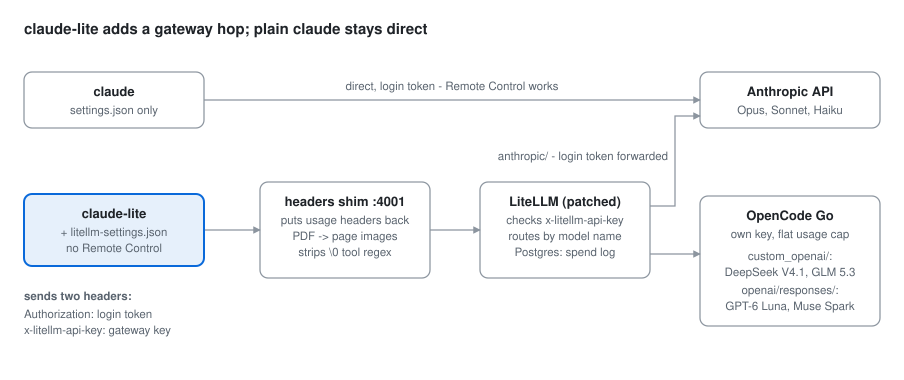

# dual-claude-code-setup

## What and why

**What.** Two Claude Code commands on one machine:

- **`claude`**: unchanged. Direct to Anthropic with your Claude subscription. Remote Control works.
- **`claude-lite`**: the same Claude Code, with the same login, permissions, hooks and
  plugins, but through a self-hosted [LiteLLM](https://github.com/BerriAI/litellm) gateway.
  It adds DeepSeek V4.1 Flash, GLM 5.3 Flash, GPT-6 Luna and Muse Spark 1.3 on an
  [OpenCode Go](https://opencode.ai/docs/go) subscription. They show in the `/model` picker
  next to Opus, Sonnet and Haiku, and you can change model in the middle of a session.

**Why.**

- **Save the Claude quota for the work that needs it.** Routine work (searches, edits,
  scripted runs) can go to a cheaper model on a flat-price subscription, in the same tool,
  with the same hooks and permissions.
- **Keep `claude` as it is.** Claude Code turns Remote Control off for any base URL that is
  not Anthropic's. So the gateway lives in a separate command with its own settings file,
  and plain `claude` keeps Remote Control and does not depend on the gateway. The
  obvious shortcut, `ANTHROPIC_BASE_URL` in `~/.claude/settings.json`, moves every `claude`
  on the machine to the gateway and turns Remote Control off everywhere.
- **Stock LiteLLM is not enough.** With a plain LiteLLM and OpenCode Go, several things fail
  with no clear error: PDFs do not reach the model and it invents their content, the
  statusline loses the subscription usage, every interactive turn on some models answers
  400, and calls hang after a Claude Code update. This repo holds the fixes: three LiteLLM
  patches, a small proxy (the headers shim) in front of LiteLLM, and the exact config. Each
  fix is explained in [docs/pitfalls.md](./docs/pitfalls.md) and
  [docs/pdf-handling.md](./docs/pdf-handling.md).

## Set it up

Give this folder to a coding agent and ask it to follow [CLAUDE.md](./CLAUDE.md). It has
the steps and a check after each one. To do it by hand, follow the same file.

## What is in it

| Path | What |
|---|---|
| [CLAUDE.md](./CLAUDE.md) | The setup runbook: gateway, client, verification |
| [gateway/docker-compose.yml](./gateway/docker-compose.yml) | Postgres, patched LiteLLM, headers shim |
| [gateway/config.yaml](./gateway/config.yaml) | The models: 3 Claude, 4 DeepSeek effort aliases, GLM, GPT-6 Luna, Muse Spark |
| [gateway/patched/](./gateway/patched/README.md) | LiteLLM v1.106.2 with three source patches, and build-time checks |
| [gateway/headers-shim/](./gateway/headers-shim/server.py) | Restores the subscription usage headers, turns PDFs into images for DeepSeek, removes a tool-schema regex that DeepSeek and Muse refuse on Go |
| [gateway/smoke.sh](./gateway/smoke.sh) | Checks that the shim restores the usage headers |
| [client/](./client/install.sh) | `claude-lite` wrappers (sh, PowerShell), the settings template, the installer, an optional statusline |
| [docs/pitfalls.md](./docs/pitfalls.md) | Symptom, cause and fix for each known trap |
| [docs/pdf-handling.md](./docs/pdf-handling.md) | How a PDF reaches each model, and why each step exists |

## Models

| `/model` name | Picker row | Provider |
|---|---|---|
| `claude-opus-5`, `claude-sonnet-5`, `claude-haiku-4-5` | built-in Opus, Sonnet, Haiku | Anthropic, your subscription |
| `deepseek-v4.1-flash-high` | DeepSeek High | OpenCode Go |
| `glm-5.3-flash` | GLM 5.3 Flash | OpenCode Go |
| `gpt-6-luna` | GPT-6 Luna | OpenCode Go, Responses API |
| `muse-spark-1.3` | Muse Spark 1.3 | OpenCode Go, Responses API |
| `deepseek-v4.1-flash-none`, `-low`, `-max` | none: type `/model <name>` | OpenCode Go |

## Requirements

- Claude Code, logged in with a Claude Pro or Max account. An Anthropic API key login is
  not tested; the shim's usage headers need a subscription login.
- A Docker host for the gateway, and an HTTPS reverse proxy on your LAN or VPN. Do not
  expose the gateway to the internet: it forwards your Claude login token.
- An OpenCode Go subscription and API key.
- Linux or macOS for the installer. Windows works with
  [client/claude-lite.ps1](./client/claude-lite.ps1) and a manual settings file.

## Limits

- Remote Control does not work in `claude-lite`. That is Claude Code's rule for any
  non-Anthropic base URL.
- A Claude Code `Read` of a PDF fails on GLM 5.3 Flash. See
  [docs/pdf-handling.md](./docs/pdf-handling.md).
