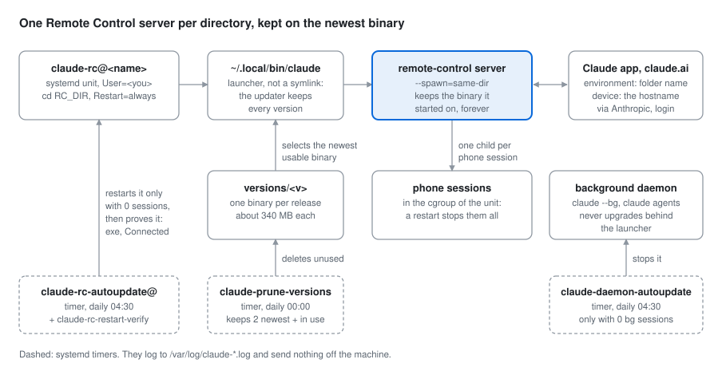

# Remote Control server

`claude remote-control` is a server. It connects a directory on this machine to the Claude
mobile app and to claude.ai, and it spawns one Claude Code session for each session that you
start there. [../remote-control/](../remote-control/install.sh) runs it under systemd, so that it
is always available. This file explains the mechanism. The setup steps are in
[../CLAUDE.md](../CLAUDE.md), step 4.



The measurements are from Claude Code 2.1.246 to 2.1.322 on one Ubuntu 22.04 host (systemd
249), where the server runs as root, unless a section says otherwise. The installer, the unit
(up to the login check), the daemon gate, the prune and the verify script were also tested on
Ubuntu 24.04 (systemd 255) with a normal user. Claude Code changes often, so check a fact again
before you build on it.

## The parts

| Part | What it does |
|---|---|
| [claude-rc@.service](../remote-control/claude-rc@.service) | One server per directory. `/etc/claude-rc/<name>.conf` sets `RC_DIR`, `RC_NAME`, `RC_PERMISSION_MODE` |
| [claude-launcher.sh](../remote-control/claude-launcher.sh) | Replaces the installer's symlink at `~/.local/bin/claude`. It turns off the updater's version cleanup |
| [claude-prune-versions.sh](../remote-control/claude-prune-versions.sh) | The cleanup instead: daily at 00:00, keeps the 2 newest versions and every version that a process executes |
| [claude-rc-autoupdate.sh](../remote-control/claude-rc-autoupdate.sh) | Daily at 04:30: moves a server to the newest version, only when it has no session |
| [claude-rc-restart-verify.sh](../remote-control/claude-rc-restart-verify.sh) | Does the restart and proves that the server came back |
| [claude-daemon-autoupdate.sh](../remote-control/claude-daemon-autoupdate.sh) | Daily at 04:30: moves the background-session daemon to the newest version, only when no background session runs |
| [claude-instances.py](../remote-control/claude-instances.py) | Read-only: every Claude process, its version, its unit, and a `claude --resume` line for each session |
| [claude-rc-sessions.py](../remote-control/claude-rc-sessions.py) | Read-only: the sessions started from the phone, with their UUIDs |

The root scripts read `/etc/claude-rc/host.conf` (`CLAUDE_USER`, `CLAUDE_HOME`). Each one logs to
`/var/log/<script name>.log` and to the journal of its unit. Nothing is sent off the machine:
read the logs, or `journalctl -u 'claude-*'`.

**One server serves one directory.** A session from the phone starts in the `RC_DIR` of the
server that you select, so each directory is its own instance and its own environment in the app.

**The app shows the machine by its hostname.** The environment shows the directory name, and
the device shows the hostname of the machine. `--name` (`RC_NAME`) is only the name of the
session (`Name for the session (shown in claude.ai/code)`). So two machines with the default
hostname `ubuntu` look the same in the app. Give each server host a unique hostname
(`hostnamectl set-hostname <name>`), then restart the server. Measured on 2.1.322: after a
hostname change and a restart, the app showed the new name, and the server kept its
environment ID.

**The first run asks for consent.** `claude remote-control` asks `Enable Remote Control? (y/n)`
once per user. A service has no terminal, so it gets no answer, exits, and `Restart=always`
starts it again every 15 s:

```
Remote Control did not start: "Enable Remote Control?" got no answer. Run `claude remote-control` at a terminal and answer y once; it won't ask again.
```

A `y` stores `remoteDialogSeen: true` in `~/.claude.json`, and does nothing else (read from the
2.1.322 binary, and measured). So `install.sh --enable-remote-control` sets that key, when the user
said yes. The other way is to run `claude remote-control` once in a terminal and answer `y`.

## Why the launcher: the updater deletes the running binary

The native updater puts each version in `~/.local/share/claude/versions/<version>` and points
the symlink `~/.local/bin/claude` at the newest one. Then it deletes old versions. It does not
check whether a process executes one.

Claude Code keeps `process.execPath` from its start and uses it for every child process. A
long-lived server whose binary was deleted keeps running, but every session spawn fails with
`ENOENT`. `systemctl status` says `active (running)` the whole time. Measured: 24 hours in that
state before anyone saw it.

The [setup docs](https://code.claude.com/docs/en/setup) ("Auto-updates") give the way out:

> With a custom launcher, Claude Code also keeps every installed version on disk because it
> can't tell which version the launcher needs.

So `install.sh --launcher` puts a small script at `~/.local/bin/claude`. It executes the newest
usable binary in `versions/`. It skips a binary that is not executable or is smaller than 10 MB,
because the updater can leave a 0-byte placeholder
([anthropics/claude-code#14791](https://github.com/anthropics/claude-code/issues/14791)).
`claude-prune-versions` then does the cleanup, and it never deletes a version that a process
executes.

- `claude doctor` warns about the launcher. That is expected. Do not put the symlink back.
- `autoUpdates: false` in `~/.claude.json` did not stop new binaries from landing in `versions/`.

## The server never adopts a new version on its own

The server keeps the binary it started on. So these drift apart, and the gap grows with every
release:

| Command | What it reports |
|---|---|
| `claude --version` | the newest binary on disk: the launcher selects it for each new process |
| `readlink /proc/$(systemctl show claude-rc@<name> -p MainPID --value)/exe` | the version that the server runs, from its last start |
| `claude daemon status` (`version:` line) | the version of the background-session daemon, and so of every background session |

Measured: a server ran a version 15 days and 4 releases older than the newest binary.
**`claude --version` is not evidence about the server.** Read the exe of the MainPID.

Nobody closed the gap by hand, because a restart stops every session of the server. So
`claude-rc-autoupdate@<name>.timer` does it at 04:30, and only when the server has no session.

- **A session is any process other than the MainPID, in the unit's cgroup, that executes a
  `versions/` binary.** The cgroup is what the restart stops, not only the children of the
  server. A phone session that runs `claude --bg` starts the background daemon in the cgroup of
  the server, and the daemon stays after the phone session ends.
- **There is no "it looks idle" test.** A healthy session waits in `ep_poll` with no CPU use for
  half an hour after a turn, and then the user comes back to it.
- **The cost is starvation.** A phone session that stays attached blocks the update forever. So
  when the newest binary is 7 days old and still not adopted, the gate logs a `WARN:` line every
  day that names the PIDs to free.
- **The gate asks the launcher which version it selects.** It does not scan `versions/` itself.
  A second copy of that rule would disagree with the launcher on the first 0-byte placeholder.
- **A newer landing is not a failure.** A release can land between the decision and the restart
  (measured: 7 s before). Only an older landing means that the launcher fell through a bad
  binary, and the verify script reports that as `DEGRADED`.

## A restart stops every session in the cgroup

`KillMode=control-group`, and the server is the parent of every session it spawns. So a
session that runs inside `claude-rc@<name>` cannot restart its own unit and then check the
result. To update now, without a wait for 04:30:

1. Save the UUIDs of the live sessions. `~/.claude/sessions/<pid>.json` exists only while the
   process runs, `/resume` hides phone sessions, and after the restart `claude --resume <uuid>`
   is the only way back to a transcript. `claude-instances` prints the commands.
2. From a shell that is **not** inside the unit (an SSH login, for example), run as root:
   `claude-rc-autoupdate <name>`. It restarts only if no session is live.
3. From a session **inside** the unit, give the job to PID 1 and stop:
   ```sh
   systemd-run --unit=claude-rc-restart --on-active=90 --collect \
     --property=Type=oneshot --property=TimeoutStartSec=600 \
     /usr/local/sbin/claude-rc-restart-verify <name>
   ```
   The session that sends this does not see the result. Read the last `RESULT:` line in
   `/var/log/claude-rc-restart-verify.log` later.

The flags are necessary:

- `TimeoutStartSec=600`: a `Type=oneshot` unit from a unit file gets no start timeout, but a
  transient unit from `systemd-run` gets the manager default, 90 s. The verify script can take
  about 5 minutes, so without the flag it is stopped before it reports.
- `--on-active=90`: without a delay the restart stops the calling session before its last
  message arrives. The value is a minimum: with the default `AccuracySec=1min`, a test with
  `--on-active=10` started at +16 s.

## `systemctl status` is not verification

The unit can read `active (running)` while every session spawn fails. These are the tests that
prove a good restart, and the verify script runs all of them:

1. The MainPID changed.
2. Its `/proc/<pid>/exe` is in `versions/`, with no ` (deleted)` at the end.
3. A new `~/.local/bin/claude --version` exits 0.
4. The journal since the restart contains `Connected`.

The server repaints a TUI status block about once a second, also with no terminal. Remove the
ANSI codes before you grep the journal:

```sh
journalctl -u claude-rc@<name> --since "10 min ago" -o cat \
  | sed -e 's/\x1b\[[0-9;]*[a-zA-Z]//g' -e 's/\x1b\][^\x07]*\x07//g'
```

The repaint was measured at about 300 journal lines per minute. The unit sets
`LogRateLimitBurst=50` per 60 s, so the startup lines pass and the repaint is suppressed.

## The background-session daemon

`claude --bg`, a session sent to the background, and `claude agents` all use one on-demand
daemon (`versions/<v> daemon run ... --origin transient`, log `~/.claude/daemon.log`). Every
background session runs on the **daemon's** binary, not on the binary of the session that you
sent to the background.

The daemon restarts for an upgrade only when `realpath(~/.local/bin/claude)` changes. With the
launcher that path is a regular file, so the realpath never changes. **The launcher causes
this.** On 2.1.280 the daemon also compares the mtime, but it skips that comparison when it runs
from `versions/`, so `touch ~/.local/bin/claude` does not help. The daemon exits only when no
client and no worker holds it.

Measured: the daemon ran 2.1.246 for 26 days. Newer clients gave its spares a flag that they
did not know:

```
bg settled 9ac590e9 (crashed): exit 1 before init — error: unknown option '--inherit-permission-mode'
```

and then a background session on a new model failed:

```
API Error: 400 Claude Code 2.1.246 does not support this model; version 2.1.280 or newer is required.
```

`claude daemon stop --any` moves the daemon to the newest binary: the next client starts a new
daemon through the launcher. `--any` is necessary because the daemon is `origin=transient`.
`claude-daemon-autoupdate.timer` does the stop at 04:30, only when no worker in
`~/.claude/daemon/roster.json` is alive with its recorded `procStart`. The roster keeps dead
entries after the daemon stops, so the `/proc` check is what counts. Do not rely on
`--keep-workers`: nothing shows that a kept worker survives the stop.

Two more facts about the daemon:

- **It lives in the cgroup of the process that started it.** A `claude --bg` from a systemd
  service can put the daemon in that service's cgroup. Then the default `KillMode=control-group`
  stops the daemon, and every background session on it, when the service exits. Use
  `KillMode=process` in such a service.
- **`claude --bg` refuses a directory that is not trusted**, with `Workspace not trusted`. A
  subdirectory of a trusted directory is trusted.

## Phone sessions

A session started from the phone or claude.ai runs as a child of the server:
`versions/<v> --print --sdk-url .../sessions/cse_... --session-id cse_...`. Its transcript is in
the normal project folder, with `"entrypoint":"sdk-cli"`. Measured on 2.1.263 to 2.1.278:

- **`/resume` and `claude --resume` hide every `sdk-cli` session.** The transcript is still on
  disk, and `claude --resume <uuid>` works when you know the UUID
  ([anthropics/claude-code#94369](https://github.com/anthropics/claude-code/issues/94369)).
  `claude-rc-sessions` lists them with their UUIDs.
- **The name that the phone shows is not a local ID.** `/resume <that name>` answers
  `Session ... was not found`.
- **An archive stops the child process. An unarchive does not start it again.**
- **A restart of the server does not bring the sessions back.** At start the server adopts only
  the session in `~/.claude/projects/<slug>/bridge-pointer.json`
  ([anthropics/claude-code#91087](https://github.com/anthropics/claude-code/issues/91087)).
- **`ps` cannot tell an idle session from a stuck one.** `Sl` with `WCHAN ep_poll` in
  `ps -o stat,time,%cpu,wchan:20 -p <pid>` and no CPU change over a few seconds means that the
  session waits for input.
- **To move a session to a terminal, archive it in the app first,** then run
  `claude --resume <uuid>` in its directory. An archived entry does not come back on its own.
  After a plain `kill`, the phone entry stays.

**Phone sessions get no Artifact tool** unless `~/.claude/settings.json` has
`"env": {"CLAUDE_CODE_ARTIFACT": "1"}` (open bug
[anthropics/claude-code#88731](https://github.com/anthropics/claude-code/issues/88731), measured
on 2.1.318). A change to `settings.json` reaches the next phone session with no restart of the
server.

## The server and the gateway

The server runs plain `claude`. It reads `~/.claude/settings.json`, and Remote Control refuses
to start when `ANTHROPIC_BASE_URL` is not `api.anthropic.com`. So the rule "never put the gateway
env in an auto-loaded settings file" in [../CLAUDE.md](../CLAUDE.md) also protects the server.
`install.sh` warns when it finds the gateway env there.

A `claude` started from inside `claude-lite` inherits the gateway env, so it has no Remote
Control. See [pitfalls.md](./pitfalls.md).

## Do not run `claude remote-control --help`

On 2.1.301 it printed nothing and ran until it was stopped. Treat it as a server start.
